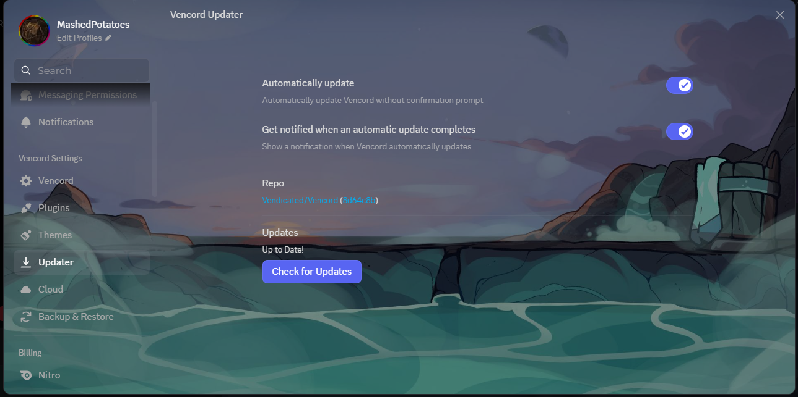

# IntereaBlue

A Discord theme with a full-picture background, based on **[FrostedGlass](https://github.com/DiscordStyles/FrostedGlass) by Gibbu** and customized by **[LeonTheFVN](https://github.com/LeonTheFVN)**.

FrostedGlass already gives you a custom picture with adjustable blur and brightness. This version adds a few extra fixes so the picture shows up in more places.

## Preview

| Main window | Home button |
| --- | --- |
|  |  |

| User Settings | Right-click menu |
| --- | --- |
|  |  |

## What's customized

On top of the stock FrostedGlass theme, this version adds:

- **Custom home button image.** Your own image replaces the default Discord icon.
- **Emoji picker background.** The picker uses the popout image with a dark layer so emojis stay readable.
- **User Settings background.** The whole settings window, including its title bar, shows a picture instead of flat gray.

## Install

Tested on **Vencord**.

> Client mods like Vencord go against Discord's Terms of Service. Use them at your own risk.

### 1. Get Vencord

1. Download the installer from the official site, [vencord.dev](https://vencord.dev).
2. Run it and follow the wizard: pick your Discord install and click Install.
3. Restart Discord.

### 2. Add the theme

1. In Discord, open **Settings > Vencord > Themes**.
2. Click the folder icon to open the themes folder.
3. Put `intereablue.theme.css` in that folder.
4. Turn the theme on in the Themes list.

You can also load it by link: in the same tab, paste the raw file link (`https://raw.githubusercontent.com/LeonTheFVN/Interea-discord-theme/main/intereablue.theme.css`) into the **Online Themes** box.

The file should also work in BetterDiscord's themes folder, but I haven't tested that.

## Change the pictures

All the pictures are set at the top of the theme file, in the `:root` block. Replace the URLs with your own **direct image links** (ending in `.jpg`, `.jpeg`, `.png` or `.gif`):

```css
--background-image: url('https://example.com/background.jpg');
--popout-image: url('https://example.com/popout.jpg');
--overlay-image: url('https://example.com/overlay.jpg');
--home-button-image: url('https://example.com/home-button.png');
```

The same block has the blur, size, position and brightness settings, for example `--background-image-blur`, `--popout-image-blur` and `--middle-brightness`. Set a blur to `0px` for a sharper picture. Reload Discord with `Ctrl+R` after saving.

## Known limitations

- **The in-game overlay isn't themed.** It runs in its own window, and the theme didn't apply there in my testing.
- **The custom fixes may break after Discord updates.** They target Discord's page structure, which changes now and then. The custom rules at the bottom of the file use these selectors, so check them first if something stops working:
  - Home button: `[data-list-item-id="guildsnav___home"]`
  - Emoji picker: `[aria-label="Expression Picker"]`
  - User Settings: `[data-mana-component="layer-modal"]` together with `nav[aria-label="Settings pages"]`
- **The settings rules use the CSS `:has()` selector.** They need a reasonably recent Discord client, and Vencord warns that `:has()` can cause lag in themes. If Discord feels sluggish, try turning the theme off to check, and open an issue.

## Credits

- **Theme base:** [FrostedGlass](https://github.com/DiscordStyles/FrostedGlass) by Gibbu (MIT license). Please keep this credit if you fork or share it.
- **Customization:** [LeonTheFVN](https://github.com/LeonTheFVN)
- **Images:** illustrations from the visual novel Interea, developed by the Echo Project team (https://echoproject.itch.io/). The images are linked from external hosting and are not part of this repository. All rights belong to their creators. Here is a link to the novel's page: https://echoproject.itch.io/interea
