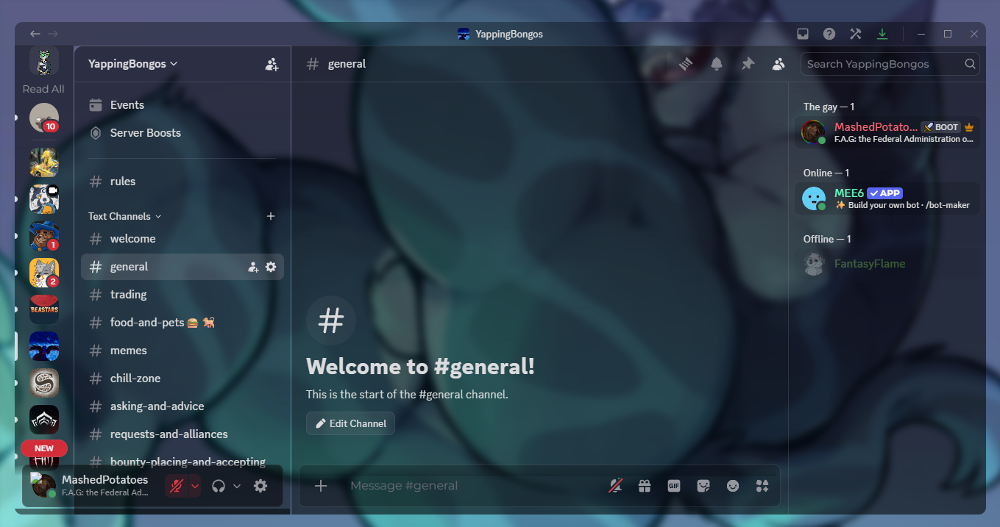
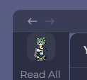
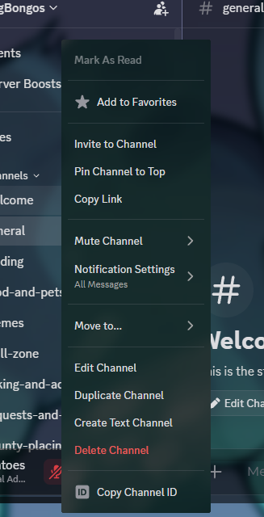
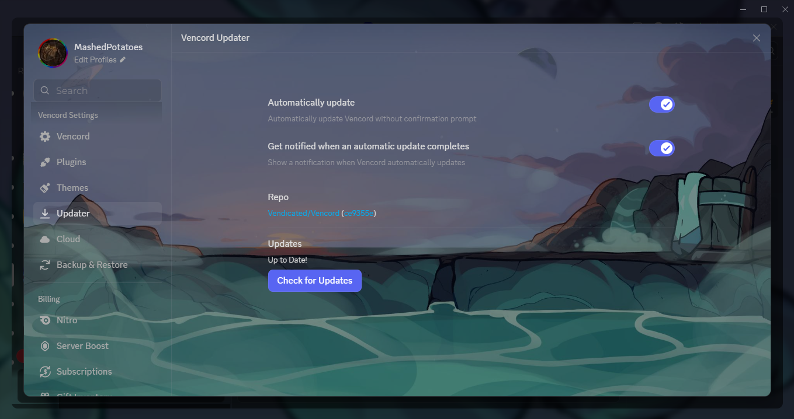
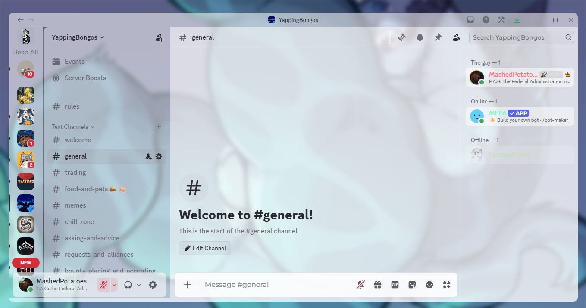
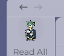
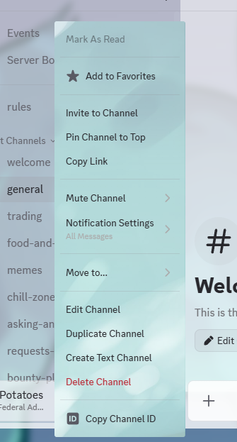
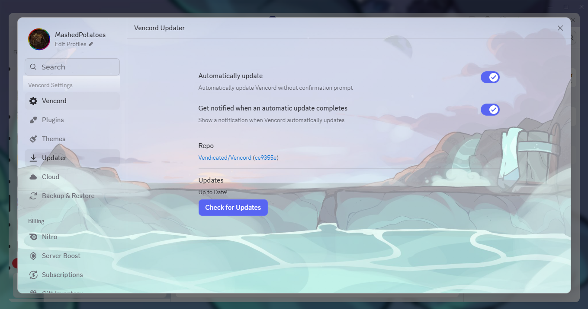

# IntereaBlue

A Discord theme with a full-picture, frosted-glass background, based on **[FrostedGlass](https://github.com/DiscordStyles/FrostedGlass) by Gibbu** and customized by **[LeonTheFVN](https://github.com/LeonTheFVN)**.

FrostedGlass gives you a custom picture behind Discord. This version rebuilds that look so it works with the current Discord client, and adds a few extra touches, including a light "cozy white" mode.

**Desktop only.** This is a CSS theme, and the Discord mobile app doesn't support CSS themes.

## Preview

### Dark

| Main window | Home button |
| --- | --- |
|  |  |

| Right-click menu | User Settings |
| --- | --- |
|  |  |

### Light ("cozy white")

| Main window | Home button |
| --- | --- |
|  |  |

| Right-click menu | User Settings |
| --- | --- |
|  |  |

## What's customized

On top of the stock FrostedGlass theme, this version adds:

- **Frosted-glass window.** The app floats as a rounded window inside the picture. The picture is blurred and shows softly through each panel, with a lighter haze over the chat and a stronger one over the side panels.
- **Cozy white mode.** Pick Discord's **Light** theme (Settings > Appearance) and the panels get a milky white veil instead of a black one. Chat text, secondary text, the typing cursor, the reply bar, the title bar and right-click menus are darkened to stay readable.
- **Title bar strip.** The title bar has its own haze and a thin edge so it reads as separate from the background.
- **Custom home button image.** Your own image replaces the default Discord icon.
- **Right-click menus.** Menus show a picture behind them (in Light mode with a white layer so the text stays readable).
- **Emoji picker background.** The picker uses the popout image with a layer over it so emojis stay readable.
- **User Settings background.** The whole settings window, including its title bar, shows a picture instead of flat gray.

## Install

Tested on **Vencord**.

> Client mods like Vencord go against Discord's Terms of Service. Use them at your own risk.

### 1. Get Vencord

1. Download the installer from the official site, [vencord.dev](https://vencord.dev).
2. Run it and follow the wizard: pick your Discord install and click Install.
3. Restart Discord.

### 2. Add the theme

1. In Discord, open **Settings > Vencord > Themes**.
2. Click the folder icon to open the themes folder.
3. Put `Intereablue.theme.css` in that folder.
4. Turn the theme on in the Themes list.

You can also load it by link: in the same tab, paste the raw file link (`https://raw.githubusercontent.com/LeonTheFVN/Interea-discord-theme/main/Intereablue.theme.css`) into the **Online Themes** box.

The file should also work in BetterDiscord's themes folder, but I haven't tested that.

## Settings

Everything you can change is at the top of the theme file, in the `:root` block. After you save, Vencord applies the change straight away.

### Pictures

Replace the URLs with your own **direct image links** (ending in `.jpg`, `.jpeg`, `.png` or `.gif`):

```css
--background-image: url('https://example.com/background.jpg');   /* behind the whole app */
--popout-image: url('https://example.com/popout.jpg');           /* User Settings and emoji picker */
--overlay-image: url('https://example.com/overlay.jpg');         /* right-click menus */
--home-button-image: url('https://example.com/home-button.png'); /* home button */
```

### Glass look (dark)

| Setting | Default | What it does |
| --- | --- | --- |
| `--blur-base` | `5px` | Blur of the whole picture. Bigger is hazier. |
| `--haze-colour` | `0,0,0` | Colour of the veil (R,G,B). Try `20,25,50` for a softer blue-black. |
| `--haze-side` | `0.50` | Veil over the server list and channel list. |
| `--haze-chat` | `0.14` | Veil over the chat area and member list. |
| `--haze-user` | `0.50` | Veil over the bottom user panel. |
| `--haze-input` | `0.10` | Veil over the message box. |
| `--haze-titlebar` | `0.35` | Veil over the title bar strip. |
| `--blur-titlebar` | `6px` | Extra blur behind the title bar (may not show on every Discord version). |
| `--titlebar-space` | `30px` | Gap above the window, so the minimise, maximise and close buttons fit. |
| `--window-padding` | `20px` | Gap between the window and the screen edge. |
| `--window-roundness` | `10px` | Corner roundness of the window. |

The veil strengths go from `0` (clear) to `1` (solid). The older FrostedGlass brightness and blur settings are still in the file, but they no longer affect the look.

### Cozy white (Light theme)

| Setting | Default | What it does |
| --- | --- | --- |
| `--light-haze-colour` | `255,255,255` | Colour of the veil in Light mode (R,G,B). |
| `--light-haze-side` | `0.55` | Veil over the channel list. |
| `--light-haze-chat` | `0.50` | Veil over the chat area and member list. |
| `--light-haze-user` | `0.55` | Veil over the bottom user panel. |
| `--light-haze-input` | `0.60` | Veil over the message box. |
| `--light-haze-titlebar` | `0.55` | Veil over the title bar strip. |
| `--light-overlay` | `0.55` | White layer over the picture in the settings window, emoji picker and right-click menus. |
| `--light-text-colour` | `#606063` | Chat message text in Light mode. |
| `--light-text-muted-colour` | `#707075` | Secondary text: member list headings, status lines, the channel intro. |

## Known limitations

- **The in-game overlay isn't themed.** It runs in its own window, and the theme didn't apply there in my testing.
- **Offline members look faded.** That's Discord's own dimming, and it applies in every theme.
- **The custom fixes may break after Discord updates.** They target Discord's page structure, which changes now and then. The custom rules at the bottom of the file use these selectors, so check them first if something stops working:
  - Background layer: `[class*="app_"] > div[class*="bg_"]`
  - Title bar: `[data-window-chrome="true"]`
  - Home button: `[data-list-item-id="guildsnav___home"]`
  - Emoji picker: `[aria-label="Expression Picker"]`
  - Right-click menus: `[data-popover-layer] [role="menu"]`
  - User Settings: `[data-mana-component="layer-modal"]` together with `nav[aria-label="Settings pages"]`
  - Light mode text: `[id^="message-content-"]`, `[class*="membersGroup_"]`, `[class*="subText_"]`
- **The settings rules use the CSS `:has()` selector.** They need a reasonably recent Discord client, and Vencord warns that `:has()` can cause lag in themes. If Discord feels sluggish, try turning the theme off to check, and open an issue.
- **The old FrostedGlass title bar addon was removed.** It conflicted with Discord's current title bar and hid the window buttons.
- **The theme can't be switched off from the Themes list.** Vencord applies it live as soon as the file is in the themes folder, so to turn it off, move the file out of the folder.

## Credits

- **Theme base:** [FrostedGlass](https://github.com/DiscordStyles/FrostedGlass) by Gibbu (MIT license). Please keep this credit if you fork or share it.
- **Customization:** [LeonTheFVN](https://github.com/LeonTheFVN)
- **Images:** illustrations from the visual novel [Interea](https://echoproject.itch.io/interea), developed by the [Echo Project](https://echoproject.itch.io/) team. The theme's pictures are hosted in this repository (`Images/Assets`) only so the theme can load them; all rights belong to their creators.
